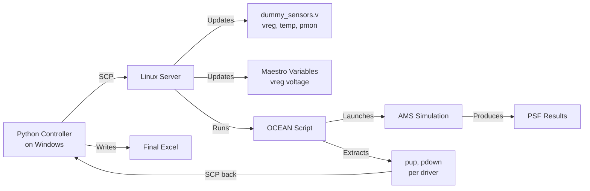

# Automated PVT Corner Verification via OCEAN Script

## Background

The user has a working Cadence AMS simulation with an ML-based Decision Tree trim predictor (`dt_trim_predictor.v`) driving a 14-bit analog TX driver. The simulation currently runs for a single PVT corner. The goal is to automate sweeping across all corners in the Excel lookup table, running the simulation for each, and collecting the output resistance measurements into a final Excel file.

## Architecture Overview

## User Review Required

> [!IMPORTANT]
> **Which corners do you want to sweep?** Your Excel has 13 sheets with thousands of rows each. Do you want to:
> - (A) Sweep only the 24 test cases in `Test_case_Mar20` sheet? *(recommended first)*
> - (B) Sweep all ~3300 corners from one specific sheet (e.g. `SS_vdd_test`)?
> - (C) Sweep ALL sheets (FF, SS, TT, FS, SF) — ~16,500 corners total?

> [!IMPORTANT]
> **Which 4 drivers?** You mentioned "4 drivers 50 ohm measurement". From your Maestro outputs I see: `outp`, `outn`, `outp_3070`, `outp_1090`, `outp_4555`. Which 4 of these correspond to the 4 drivers you want measured?

> [!WARNING]
> **Simulation time estimate:** Each AMS simulation takes approximately 2–5 minutes. For 24 test cases, that's ~1–2 hours. For 3300 corners, that's ~5–11 days of continuous simulation. Consider starting with the 24 test cases first.

## Open Questions

1. **pmon values:** Each corner has both `pmon_cmos_res` and `pmon_cmos` columns. Which one maps to the `pmon_in` input of your RTL? Or should we use `pmon_cmos` (the larger value)?
2. **Maestro `vreg` variable:** The schematic has a `vdc` source controlled by the Maestro variable `vreg`. Should the Python script update this too, or is it already handled by the dummy_sensors encoding?
3. **Corner type (FF/SS/TT/FS/SF):** The analog transistor models need to match the process corner. Does your current Maestro setup already handle this, or do we need to switch model files for each corner type?

## Proposed Changes

### Phase 1: OCEAN Automation Script (runs on Linux server)

#### [NEW] `ocean_pvt_sweep.ocn` — OCEAN/SKILL script
Instead of clicking the Maestro GUI for each corner, we use an **OCEAN script** that:
1. Opens the simulation environment
2. Loops through a CSV of corners
3. For each corner:
   - Updates Maestro design variables (`vreg`)  
   - Runs the transient simulation
   - Extracts `pup` and `pdown` resistance using the expressions:
     - `pup = average(clip((V("/vdd") - V("/outp")) / I("/xdrv_p/out"), 450ns, 490ns))`
     - `pdown = average(clip(V("/outn") / I("/xdrv_p/out"), 450ns, 490ns)) * -1`
   - Writes results to a CSV file

---

### Phase 2: Python Controller (runs on Windows)

#### [NEW] `scripts/pvt_sweep_controller.py`
A Python script that:
1. Reads the Excel file to extract all PVT corners (vreg, temp, pmon)
2. Generates a `corners.csv` file with encoded sensor values
3. Generates the `dummy_sensors.v` for each corner
4. SCPs files to the server
5. SSHs into the server and runs the OCEAN script
6. Waits for completion, SCPs results back
7. Merges results with original Excel data into a final verification Excel

#### [NEW] `scripts/generate_dummy_sensors.py`
A helper that generates `dummy_sensors.v` with correct encoded values:
- `vreg_out = round((V - 0.80) * 100)` → capped to 5 bits (0–31)
- `temp_out = round((C + 40) * 4)` → 10 bits
- `pmon_out = pmon_cmos value` → 29 bits

---

### Phase 3: Documentation

#### [NEW] `walkthrough.md`
Complete documentation of:
- All changes made to resolve the simulation crashes
- Step-by-step setup guide for running simulations
- Library paths, tool versions, wrapper script explanation
- How to run the automated PVT sweep

## Verification Plan

### Automated Tests
1. Run the OCEAN script on the 24 `Test_case_Mar20` corners first
2. Compare ML-predicted `pup`/`pdown` resistance with actual simulated values
3. Verify all 24 resistances are within ±2Ω of 50Ω target

### Manual Verification
- Spot-check 3 random corners by manually running them in Maestro and comparing with script output
